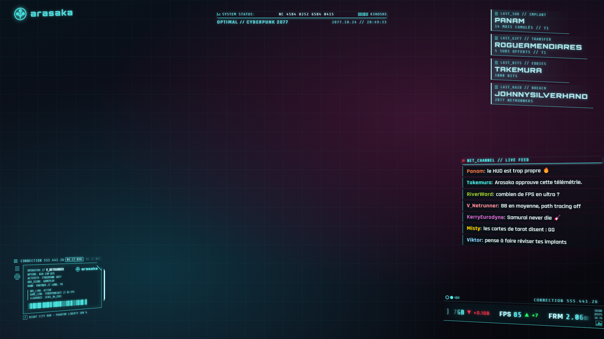
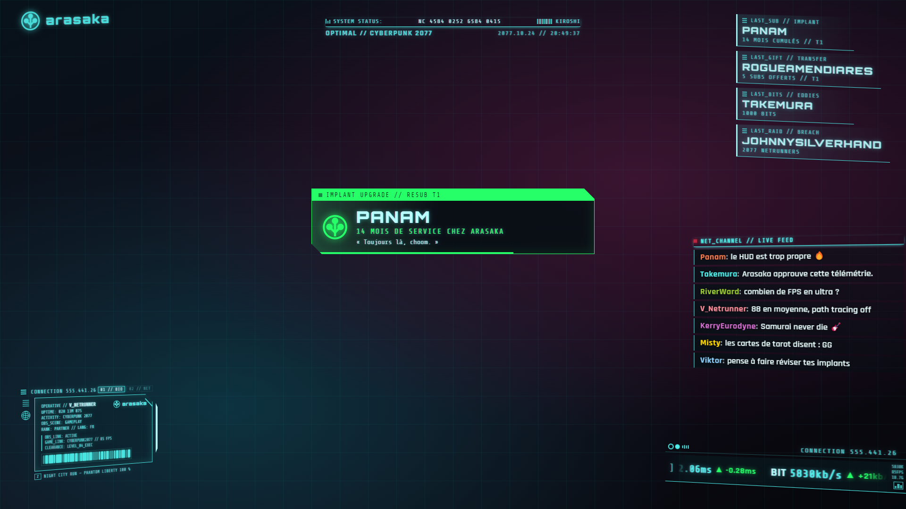
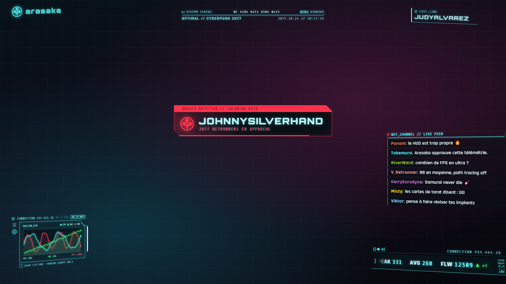
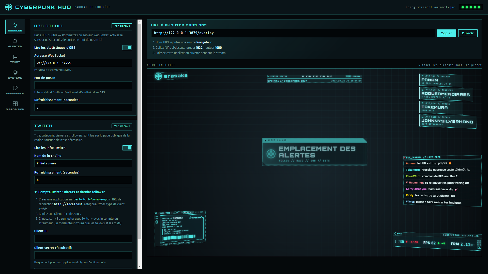
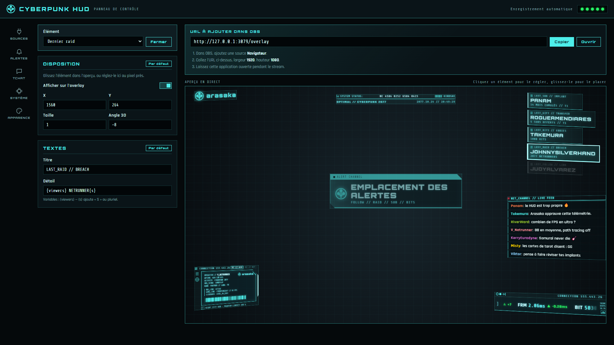

# Cyberpunk HUD

Overlay OBS style Cyberpunk 2077 (Arasaka / Kiroshi) alimenté par les vraies statistiques d'OBS et les infos publiques Twitch.

> [!NOTE]
> **Projet réalisé en grande partie à l'aide de l'IA.** L'essentiel du code, de l'architecture et de la documentation
> a été écrit par un assistant IA (Claude, d'Anthropic), sous la direction et avec les tests de l'auteur.
> Relisez-le comme tel avant de vous en inspirer.

## Aperçu

L'overlay tel qu'OBS l'affiche en 1920×1080 (ici sur un fond neutre, avec des données de démonstration) :



En haut à droite, les derniers événements de la chaîne : dernier sub (mois cumulés), derniers subs offerts (qui et combien), derniers bits et dernier raid. Ils sont mémorisés entre deux lancements. Le dernier follower existe aussi, désactivé par défaut (section Disposition).

| Alerte de resub | Alerte de raid |
| --- | --- |
|  |  |

Le panneau de réglages : les sections sont rangées par onglets (Sources, Alertes, Tchat, Système, Apparence), et l'état des services tient dans les cinq pastilles en haut à droite (un clic affiche le détail).



Dans l'aperçu en direct, on glisse un élément pour le placer ; un clic dessus ouvre ses réglages dans la colonne de gauche, avec un menu déroulant pour passer d'un élément à l'autre : affichage, position, taille, angle 3D et tous ses textes. Les textes acceptent des variables comme `{viewers}`, `{months}` ou `{bits}`, et `{s}` ajoute le « S » du pluriel :



## Pour l'utilisateur final

1. Télécharger `CyberpunkHUD-Setup-x.y.z.exe` depuis les [releases](https://github.com/YetAnotherRandomProject/cyberpunk-hud/releases/latest) et le lancer (installation dans le profil utilisateur, sans droits administrateur).
2. La fenêtre de réglages s'ouvre : renseigner OBS (adresse + mot de passe WebSocket) et la chaîne Twitch.
3. Copier l'URL affichée en haut (`http://127.0.0.1:3000/overlay`) dans une **Source navigateur** OBS en 1920×1080.
4. Laisser l'application ouverte pendant le stream.

Tous les réglages se font dans la fenêtre et sont enregistrés automatiquement dans `%APPDATA%\Cyberpunk HUD\config.json`. L'onglet Système permet d'exporter la configuration de l'overlay dans un fichier JSON, sans le Client ID, le Client secret Twitch ni le mot de passe OBS, puis de la réimporter : ces secrets et le port du serveur gardent alors leur valeur locale.

### Mises à jour

L'application vérifie au démarrage (puis toutes les 4 heures) si une nouvelle version est publiée. Elle la télécharge en arrière-plan et l'installe à sa prochaine fermeture, ou tout de suite si vous choisissez « Redémarrer maintenant ». Les réglages sont conservés.

### Alertes follow / raid / sub / bits et dernier follower (facultatif)

1. Créer une application sur [dev.twitch.tv/console/apps](https://dev.twitch.tv/console/apps) : URL de redirection `http://localhost`, catégorie *Other*, type de client *Public*.
2. Coller son Client ID dans la section Twitch, puis « Se connecter avec Twitch » et saisir le code affiché sur twitch.tv/activate.

Subs, resubs, subs offerts et bits exigent le compte du streameur lui-même (un modérateur n'a que les follows et les raids). Après une mise à jour qui ajoute ces alertes, déconnecter puis reconnecter le compte pour accorder les nouvelles autorisations.

La connexion (jetons) est stockée à part dans `twitch-auth.json`, jamais envoyée aux pages web. Les boutons « Tester » de la section Alertes fonctionnent sans connexion.

### CPU / RAM / FPS

CPU et RAM affichés sont ceux du PC entier. Les FPS sont ceux du jeu (DirectX 9 à 12, Vulkan, OpenGL), lus directement auprès de Windows par ETW, sans outil externe : section Système, mode automatique (application au premier plan en plein écran) ou fenêtre choisie. Windows réserve ETW aux administrateurs et au groupe « Utilisateurs du journal de performances » : y ajouter le compte une fois (fermer puis rouvrir la session après l'ajout), ou lancer le HUD en administrateur.

## Développement

```bash
npm install
npm run dev      # serveur (port 3000) + interface Vite à chaud (http://localhost:5173)
npm run app      # compile l'interface et lance l'application Electron
npm run dist     # produit l'installeur dans release/ (sans publier)
npm start        # serveur seul, sans Electron (config dans ./data)
```

## Architecture

```
electron/main.js            Lance le serveur puis ouvre la fenêtre de réglages
server/
  createHudServer.js        Assemble config, sources de télémétrie, HTTP et WebSocket
  standalone.js             Lancement en ligne de commande
  config/                   Schéma par défaut + stockage JSON validé
  telemetry/                État télémétrique, source OBS, source Twitch
  telemetry/system/         CPU/RAM du PC, FPS du jeu (ETW via koffi, dans un worker thread)
  chat/                     Tchat Twitch (IRC anonyme) : emotes, badges, modération
  realtime/Broadcaster.js   Diffusion WebSocket (/ws)
  http/                     Express : API REST (/api) + fichiers de l'interface
src/client/
  pages/                    OverlayPage (/overlay, pour OBS) et SettingsPage (/)
  components/overlay/       Un composant par élément du HUD
  components/settings/      Panneau de réglages, champs de formulaire
  hooks/, lib/              Logique réutilisable (WebSocket, autosave, formatage…)
```

Le flux : le serveur détient la config et l'état télémétrique, les pousse par WebSocket (`INIT`, `CONFIG_UPDATE`, `TELEMETRY_UPDATE`). Le panneau de réglages modifie la config via `PUT /api/config` ; l'overlay dans OBS se met à jour en direct.

L'ancienne version mono-fichier est conservée dans `legacy/`.

## Releases (CI/CD)

Chaque push sur `main` lance [`.github/workflows/release.yml`](.github/workflows/release.yml) : l'installeur est construit sur Windows puis publié comme release GitHub, avec le fichier `latest.yml` que lisent les applications installées pour se mettre à jour. La version est `majeure.mineure` de `package.json` suivie du numéro de build (ex. `2.0.14`) ; pour passer à `2.1.x`, modifiez la version dans `package.json`.

L'installeur n'est pas signé : Windows SmartScreen peut afficher un avertissement au premier lancement (« Informations complémentaires » → « Exécuter quand même »).
